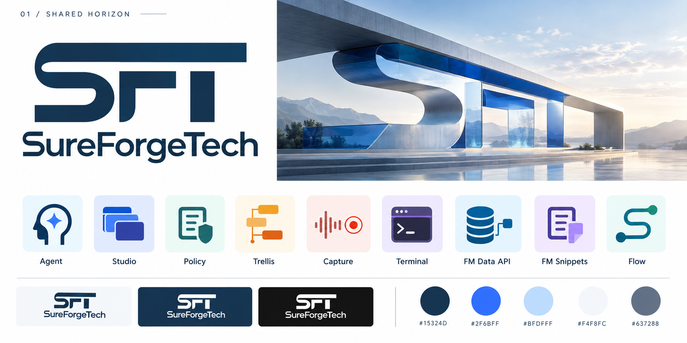
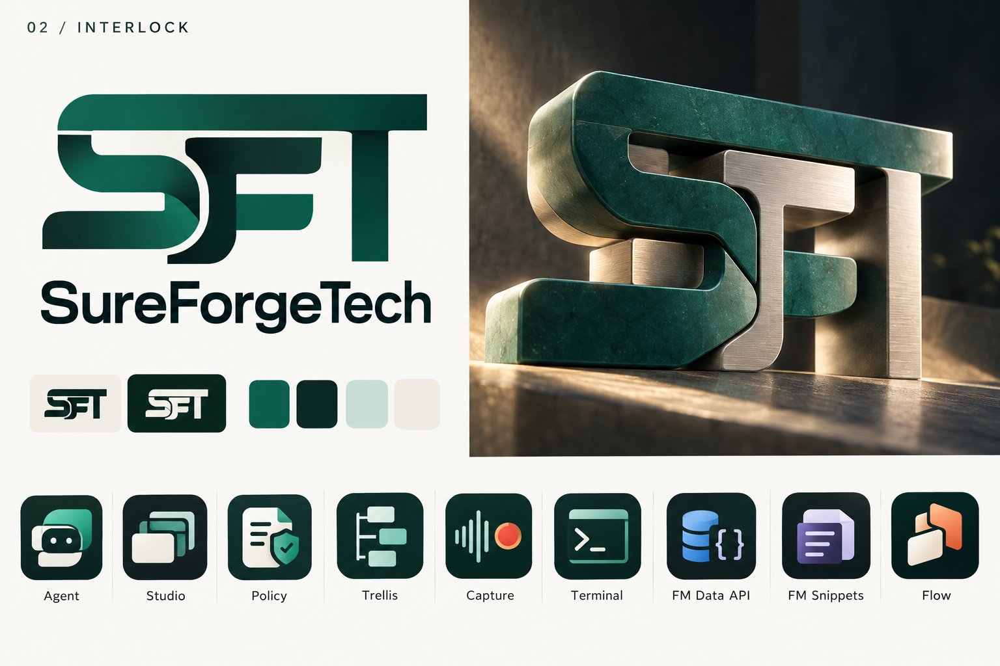
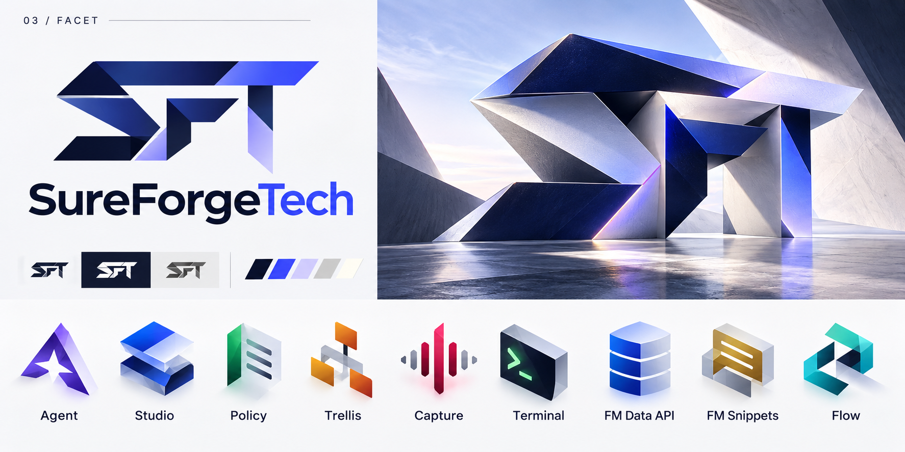
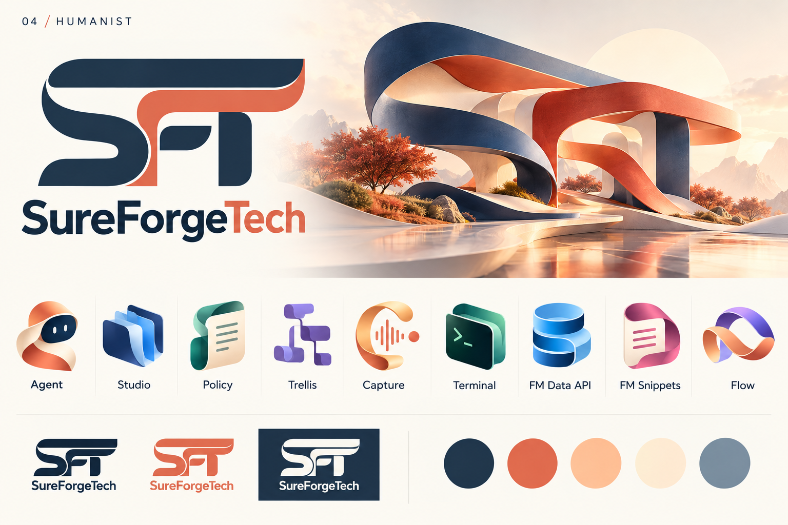
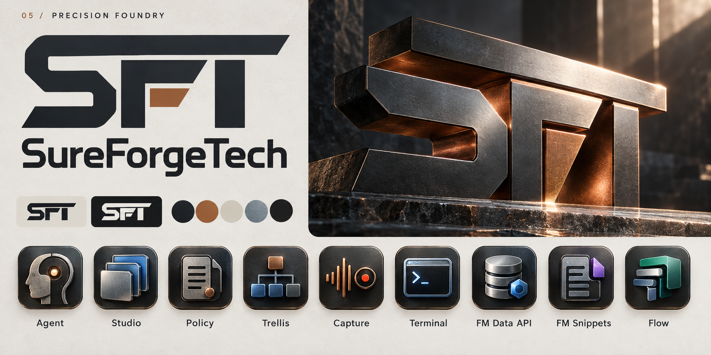
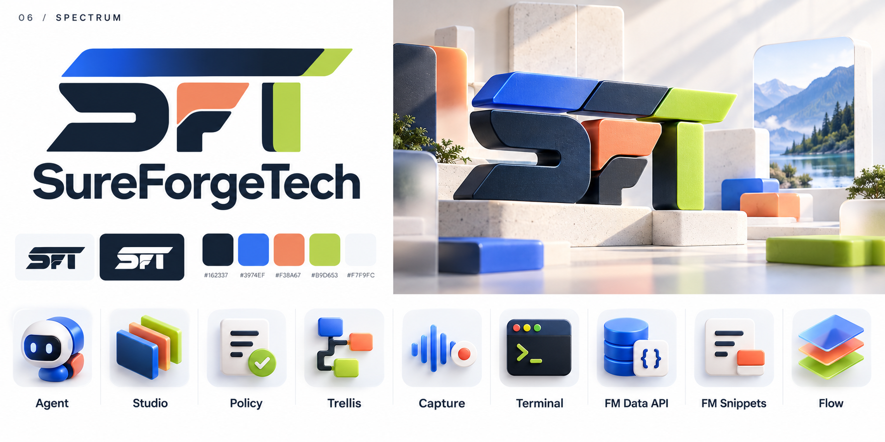

# SureForgeTech branding concepts — October 17, 2026

Six visual directions for the SureForgeTech parent brand and SureForge product family. Each board includes an integrated SFT logo, illustrative website artwork, and nine product icons.

The jade/steel direction, patinated artwork and product icons are selected for the next local website mockup. The selected mark will need vector refinement and checks at small sizes before production use. The architectural and sculptural artwork is illustrative, not a depiction of company facilities.

## Selected website assets

- [Website mockup](../../website/2026-10-17-jade/index.html)
- [Balanced brand board](refinements/j-balanced-brand-board.png)
- [Transparent logo](refinements/k-logo-transparent.png)
- [Approved product icons](refinements/approved-product-icons.png)
- [Favicon files](refinements/favicon/README.md)

## Current refinements

The latest study deepens the jade and steel and adds the bold SureForgeTech wordmark beneath the corrected monogram. Patina, graduated shading and the soft matte backdrop remain.

- [I — Dark jade + SureForgeTech wordmark](refinements/i-dark-jade-wordmark.png)
- [H — Weathered jade + soft backdrop](refinements/h-jade-patina-soft-background.png)
- [G — Jade gradient, corrected F and T](refinements/g-jade-gradient-ft.png)
- [D — Jade + Steel](refinements/d-jade-steel-sft.png)
- [E — Copper + Steel](refinements/e-copper-steel-sft.png)
- [F — Brushed Steel](refinements/f-brushed-steel-sft.png)
- [C — Initial top-bar correction](refinements/c-segmented-top-bar.png)
- [A — Earlier Jade + Steel board](refinements/a-jade-steel.png)
- [B — Earlier Graphite + Copper board](refinements/b-graphite-copper.png)
- [Feedback and design decisions](refinements/README.md)
- [Refinement prompts](refinements/prompts.json)

## Original six directions

- [Comparison gallery](index.html) — open locally in a browser to compare the refinements and original six boards.
- [Generation prompts](prompts.json)
- [Asset manifest and SHA-256 checksums](manifest.json)

| Direction | Character |
| --- | --- |
| [01 — Shared Horizon](01-shared-horizon.png) | Restrained navy identity with architectural imagery |
| [02 — Interlock](02-interlock.png) | Jade, joined letterforms, tactile materials |
| [03 — Facet](03-facet.png) | Angular geometry and ultramarine accents |
| [04 — Humanist](04-humanist.png) | Warm coral and flowing ribbon forms |
| [05 — Precision Foundry](05-precision-foundry.png) | Graphite, copper, and machined forms |
| [06 — Spectrum](06-spectrum.png) | Colorful modular product-family identity |

All boards show these nine products: SureForge Agent, SureForge Studio, SureForge Policy, SureForge Trellis, SureForge Capture (BugNarrator), SureForge Terminal, SureForge FM Data API, SureForge FM Snippets, and SureForge Flow. The boards abbreviate product labels for readability.

## Boards

### 01 — Shared Horizon

### 02 — Interlock

### 03 — Facet

### 04 — Humanist

### 05 — Precision Foundry

### 06 — Spectrum

