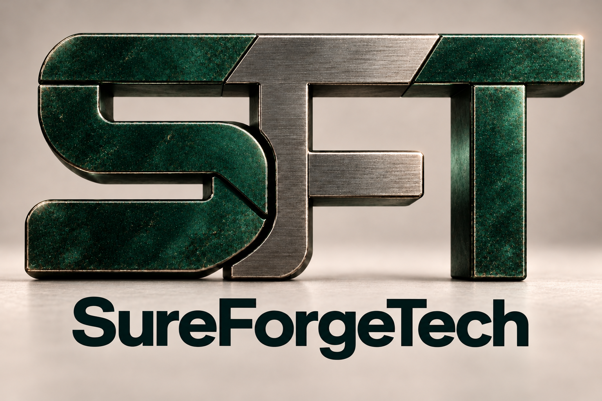
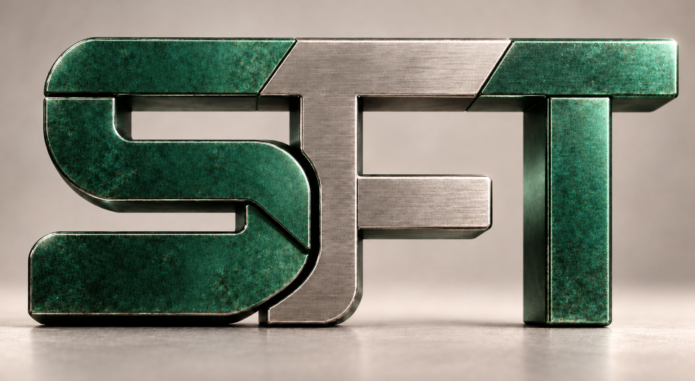
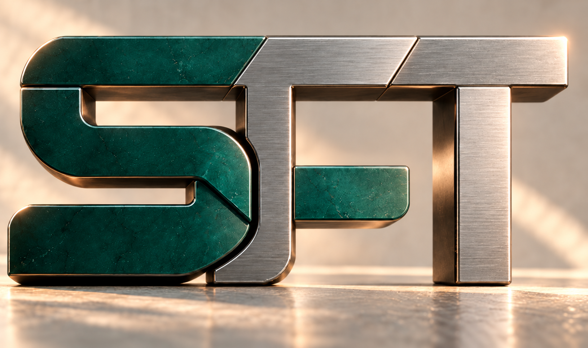

# Interlock × Precision Foundry — refinements

## Selected assets for the website mockup

- [J — Balanced SFT with the nine-product family](j-balanced-brand-board.png)
- [K — Transparent master logo](k-logo-transparent.png)
- [Original approved product-icon strip](approved-product-icons.png), preserved unchanged
- [SVG favicon](favicon/favicon.svg) and [ICO favicon](favicon/favicon.ico)
- [Website mockup](../../../website/2026-10-17-jade/index.html)

The S and F are narrower, especially the F's middle arm. The transparent master translates that construction into a clean jade-and-steel logo for a white background. It is an RGBA PNG with actual transparent negative space. The favicon is a simplified native SVG S on a jade tile, with 16, 32, 48, 180 and 256 pixel PNG exports and a multi-size ICO.

The user selected the jade/steel artwork, transparent logo and product family for the next website mockup. The website uses the original app-icon strip directly, displaying the individual icons through CSS without redrawing them.

## Earlier study: darker jade with the company name

[Open the latest logo and wordmark](i-dark-jade-wordmark.png)

Study I deepens the jade S and T toward the user's darker reference and tones down the steel F. It retains the patina, corrected shared-top construction and soft matte backdrop. The bold, dark SureForgeTech wordmark is centered beneath the monogram, following the supplied typography reference.

## Earlier study: weathered jade and a softer backdrop

[Open the latest image](h-jade-patina-soft-background.png)

The user requested more patina, light weathering, and a softer marble-like background on the jade S/T and steel F version. Study H adds richer jade tonal variation, mottled patina, fine wear and softened steel sheen. The backdrop and base are quieter matte warm-gray surfaces with diffuse light. The corrected letter shapes, shared top segments and jade gradients remain.

## Earlier study: jade gradient with corrected F and T

[Open the latest jade image](g-jade-gradient-ft.png)

The latest request corrects the F and T in the supplied jade-and-steel image while retaining its graduated jade shading, mottled patina, brushed steel and warm highlights. The F now reaches the shared top edge, its redundant upper stroke is removed, and its jade-inlaid middle arm sits lower. The T has a complete steel crossbar, with a seam separating it from the F.

- [User-supplied jade reference](g-jade-reference.png)
- [C — Initial correction of the shared top](c-segmented-top-bar.png)
- [Exact generation prompts](prompts.json)

## Separate palette studies

The requested alternatives use restrained palettes. Jade with steel and copper with steel are separate options; combining jade, steel and copper as three equally prominent letter colors was rejected.

| Study | Palette |
| --- | --- |
| [D — Jade + Steel](d-jade-steel-sft.png) | Jade S and T, steel F |
| [E — Copper + Steel](e-copper-steel-sft.png) | Copper S and T, steel F |
| [F — Brushed Steel](f-brushed-steel-sft.png) | Gunmetal S and T, lighter steel F |

These comparisons precede the latest request to restore the richer gradient in study G.

## Earlier boards and established preferences

- [A — Jade + Steel brand board](a-jade-steel.png)
- [B — Graphite + Copper brand board](b-graphite-copper.png)
- Interlock and Precision Foundry are the preferred parent-logo directions.
- Precision Foundry's substantial, less cartoonish product icons are preferred.
- The shared flat top must visibly belong to all three letters, rather than read as an S roof over a compressed F and short T.

All images were created with the built-in image-generation tool. The jade/steel direction is selected for the local website mockup. The master-logo images remain raster assets; precise vector production remains future work.
